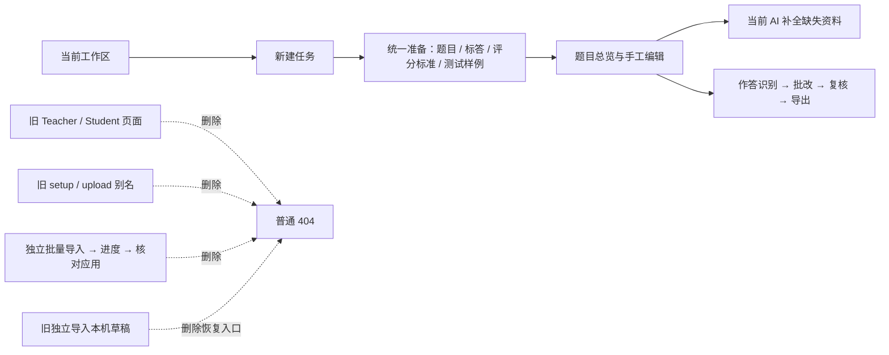

# PR302 完整清理记录

日期：2026-11-06。来源：[清除最新 main 与 PR300 的废弃代码和旧入口](codex://threads/01a1aedb-812d-74e3-b7c2-29f5574d1437)。[PR302](https://github.com/SmarTAI-2025/SmarTAI/pull/302) 累计清理内容，包括首轮清理、独立材料导入清理，以及用户追加的调用关系复查。

基线是 main `e1f8fd2542057c0a3c232e0f0b1a52bbc0b737be` + PR300 `9eedc31de3224a431f66b6d24be0141111035109`。PR302 暂以 `codex/programming-classroom-reviewed` 为 base；不包含整条 PR291。产品代码/测试/手册累计 **145 个文件变动，其中 58 个删除**；此数字不包含本报告及配图。逐文件状态见 [完整清单](changed-files.txt)。文件标记 `D` 为整文件删除，`M` 为只清理其中的旧部分。

## 1. 前端清理位置

### 已删除的独立导入页面

下面是清理前独立 `/tasks/:taskId/questions/import` 页面的真实本地截图。它位于题目审核阶段，包含“评分标准 / 标答 / 测试样例”选择、来源选择、导入按钮和本机草稿。截图来自同日 PR291 限时审计，使用合成任务；用于说明被删页面，不表示生产环境曾部署该版本。

删除页面及专属代码：

| 旧位置 | 删除范围 | 清理后行为 |
|---|---|---|
| `/tasks/:taskId/questions/import` | `QuestionMaterialImportPage` 与测试 | 普通 404，地址不跳转 |
| `…/questions/import/progress/:jobId` | `QuestionMaterialImportProgressPage` | 普通 404，不轮询旧任务 |
| `…/questions/import/review/:jobId` | `QuestionMaterialImportReviewPage`、原件预览及测试 | 普通 404，不加载或应用旧方案 |
| 本机草稿列表 | `material-import` / `material-review` 目的地址、标签、版本计算与验证脚本场景 | 无恢复链接；仅列出当前有有效目的地址的草稿 |
| 专属客户端 | `api/materialImports`、hooks、keys、types、`materialImportCopy`、旧错误文案 | 不再产生旧功能请求 |

特别处理：只删三个路由后，通用 `questions/:questionId` 会把 `import` 解释为题目 ID 并跳转。浏览器回归发现此问题后，加入唯一的 `questions/import/* → NotFoundPage` 拒绝规则。它只显示普通 404，不保留旧组件、迁移、重定向、API 或草稿兼容。

### 保留的统一准备入口

当前入口仍是 `/tasks/:taskId/upload/problems`。四个页签、资料库选择、OCR 选择、统一处理，以及缺失标答/评分标准的 AI 生成均保留。

### 旧地址与旧草稿的实际结果

桌面 1280px、手机 390px 均直接访问 25 个旧地址，断言 URL 不变、普通 404、没有脚本错误和旧导入 API 请求。下图是其中一个旧地址的结果，所有地址使用相同断言。

测试向浏览器 IndexedDB 写入两个旧导入草稿和一个当前任务信息草稿。下图仍能显示当前草稿，而两个旧草稿没有恢复入口；没有因为隐藏旧草稿而停止加载全部草稿。旧记录不迁移、不自动调用业务 API，仍受原本的到期和会话清理机制约束。

[手机四页签](images/mobile-current-task-entry.png) · [手机 404](images/mobile-retired-route.png) · [桌面草稿列表](images/desktop-current-draft-list.png) · [图片来源及 SHA-256](image-provenance.json)

## 2. PR302 累计清理清单

| 类别 | 删除内容与代码位置 | 保留边界 |
|---|---|---|
| 旧师生工作区 | `src/routes/teacher/`、`src/routes/student/` 的旧页面/测试；旧 education API/hooks、LMS 类型、角色守卫和旧导航 | 当前教师工作区、StudentUnavailablePage、课程标签及资料库 |
| 旧任务 URL | `setup`、`upload/submissions`、`upload/:kind` 旧别名与重定向 | 当前 `tasks/:taskId` 状态入口和 `submissions/upload` |
| 独立材料导入 | 上述三个页面、专属 API/hooks/types/copy、原件预览、草稿恢复；中英文手册同步删除旧流程说明 | 四页签统一准备、当前 AI completion、题目总览和详情编辑 |
| 旧后端 LMS 工作流 | `api/assignments.py`、`submissions.py`、`grading_runs.py`、`results.py`；专属 services、`submission_upload_repository`、旧测试专用 app | 当前任务 facade、共享 assignment/submission/grading repositories |
| 旧选课资源 | `/courses/{id}/students`、`/courses/{id}/enroll`；旧学生/管理员读取分支和无消费者的课程查询 | 教师课程标签、当前归属与权限验证 |
| 旧账号和邀请入口 | 开发 `/users/*`、旧 `/admin/invites` 接口/生成/兑换、旧 `/admin/users/{id}/active` 别名、未挂载的 AdminInvites/Placeholder/System 页面 | 当前注册邀请码、邮箱验证、私有后台账号权限/监控/业务配置 |
| 独立导入后端 | `task_preparation.py` 的 preflight/start/get/source/apply/draft-reference、原件复验、durable worker；`main.py` 注册；task execution/facade 的 `material_import` 分支、准入类型及错误白名单 | 当前 `question_preparation` 与 `ai_completion` 的原子写入、租约、进度、停止/继续与恢复 |
| 独立上传别名 | `upload_reference`、`upload_test_cases` 及 `_apply_auxiliary_upload`、前端封装 | 统一四种资料来源和共享匹配算法 |
| 旧解析器 | `ingest_agent.py` 的 `parse_reference_to_per_question` / `parse_test_cases_to_per_question`、专属 prompt/schema，及只测试旧 prompt 的参数 | `parse_material_import_to_candidates` 和其模型仍被统一准备直接调用，保留 |
| 无消费者前端封装 | 老单文件抽题 API/hooks/types、旧系统健康页 API/hooks/types；旧逐题分析/缓存重置、旧个人知识 CRUD、旧后台控制/统计及 refresh hook；专属 keys/types/test 残留 | 当前页面实际调用的 API、知识存储用量、当前后台读写和会话刷新实现 |
| 其他首轮死代码 | StatTile、旧 localStorage personalKnowledgeBase、旧 reviewDetail 搜索辅助模块 | 当前共享 UI、查询与持久化 |
| 旧原生编程兼容 | 自动修复旧源码映射、旧映射版本 1/2、旧输入域回执字段、临时 stdin / generated-domain 版本键 | 当前源码字节、输入域、安全执行、结果快照、人工复核与未评分语义 |
| 测试与工具 | 删除旧功能专属测试，移除旧脚本例外/浏览器场景；通用 worker/租约/原子性测试改用当前 AI completion 或明确未注册操作 | 当前统一准备、原件、OCR、编程测试用例、恢复和事务回归 |

没有重写历史 Alembic 迁移、删除共享数据库模型、迁移或销毁历史业务数据，也没有改动真实生产数据。

## 3. 审计和验证

- 从公共 `main.tsx` 与私有 `admin-main.tsx` 检查静态/动态导入和 export 图：257 个非测试 TS/TSX 文件，255 个可达；余下是 API 汇总出口和全局环境类型声明。对 API 导出函数追加消费者扫描，已无“仅声明、无其他源码引用”的函数候选。详见 [source-audit.json](source-audit.json)。该检查是可达性证据，不等于所有功能都经过行为验收。
- 后端 38 个旧 HTTP 请求，在 development/test/production × 未登录/teacher/student/admin 下均检查为 404；OpenAPI 不再暴露独立导入及两个独立上传别名，同时确认当前统一准备和 AI 补全路由存在。
- 本地追加后端回归 **1,381 项通过、7 项条件跳过**，覆盖题目准备、原件、上传、OCR、草稿引用、辅助操作、工作流/租约、停止继续、恢复、编程测试材料和当前路由；前端全量 **1,767 项通过**。删除的测试都对应退休实现；混合测试只删除旧分支，保留当前行为验证。
- 本地生产构建浏览器 **70 项通过**：旧 URL/IndexedDB 草稿、四页签、当前导航、停止继续/错误恢复/额度重试、桌面手机布局、中英文公开手册。公共和私有后台构建、类型和范围检查通过。
- 测试使用临时数据库、合成账号/文件及固定模型响应，没有真实 AI 准确率、正式学生数据或生产运行验收的含义。CI 与本地日志必须对应各自实际 SHA；首轮 `d0a6c6f0` 的成功记录不能代替追加清理后的 head。
- 最终 head、CI run 和逐阶段状态见 PR302 描述及 canonical 导航目录 `docs/project_navigation/2026-11-06-retired-cleanup/material-import-removal/` 的验证记录。正式 review、合并、部署分别记录，不由测试通过推导。

## 4. 与 PR291 的整合约束

对照 PR291 功能 head `57b4bbaad7eb80eedc79fe92d3d1a041197d0b73`；未把整条 PR291 合入本分支。后续按以下规则处理冲突，禁止恢复被删除的独立流程：

1. `frontend/app/src/api/materialImports.ts` 的修改/删除冲突选择删除；其中 `9_060_000ms` 旧 preflight 等待例外一起消失，不移动到当前 HTTP client。
2. `backend/api/task_preparation.py` 保留 PR291 对当前统一题目准备、当前 AI completion 的总时限/单次调用规则；丢弃已删除独立 preflight、start、worker、apply 中新增的计时逻辑。
3. PR291 的 `backend/services/workflow_deadlines.py::QUESTION_TYPES` 必须移除 `material_import`；保留当前统一准备 **2.5 小时**规则。不可误删共享题目时钟或 AI completion。
4. worker 注册、执行准入、停止继续、前端路由/草稿/导出、旧专属测试都保持删除。PR291 新增的独立导入计时测试不能使被删函数重新出现；当前统一流程的计时测试保留。
5. 同时改动的 analytics/type 文件逐块合并：保留 PR291 的当前 Ask 限时和滚动频率限制，保留 PR302 对无消费者前端封装的删除。所有正式组合仍须按组合 head 重新验证。

## 5. 暂不删除、待用户集中确认

以下存在当前服务合同或仍挂载的 HTTP 入口，尚不足以判定全部业务意义已废弃。已保留代码，不阻塞上述确定项完成和推送。

| 项目 | 已核实情况 | 需确认的边界 |
|---|---|---|
| 旧单来源抽题后端 | `api/tasks.py::extract_problems_endpoint`、`_extract_from_source_token` 与 `task_facade.queue_task_problem_extraction` 仍可经 HTTP 调用；当前四页签和 Demo 使用 `question_preparation`，无前端页面消费者；死前端封装已删 | 是否连公开 `/tasks/{id}/extract_problems` 和 `problem_extraction` worker/恢复合同一起下线 |
| 无当前页面消费者的后端接口 | 逐题 `/analytics/{task}/per_question/{q}` 与缓存清理、直接 `/knowledge/documents` CRUD，以及旧后台 status/session/password-reset/metrics 接口仍挂载或有服务测试；当前 UI 已改用其他入口，其死前端封装已删 | 是否取消这些 HTTP 合同；应逐项确认，避免把共享知识/账号能力一并删除 |
| 跨版本账号与存储记录 | auth 的旧 session 接纳、共享数据库记录/约束、历史迁移仍服务现存数据；`legacy` 字样还用于风险分类和拒绝旧恢复 | 是否另开“全新数据及账号迁移”任务。当前清理不承担会话失效、schema/数据销毁或历史迁移重写 |

当前统一准备使用的 `MaterialImportCandidateOutput`/`parse_material_import_to_candidates` **明确保留，无需按名字再确认删除**；这部分是当前资料匹配算法。无消费者的旧前端封装删除，也不等于相应后端合同已被取消。
