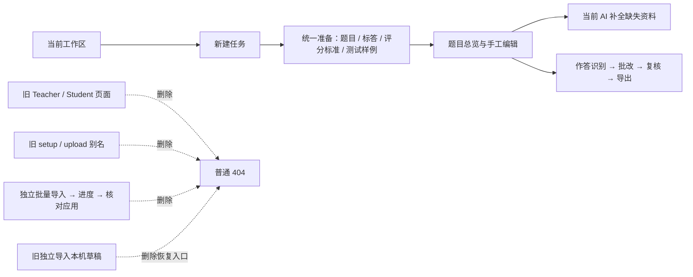
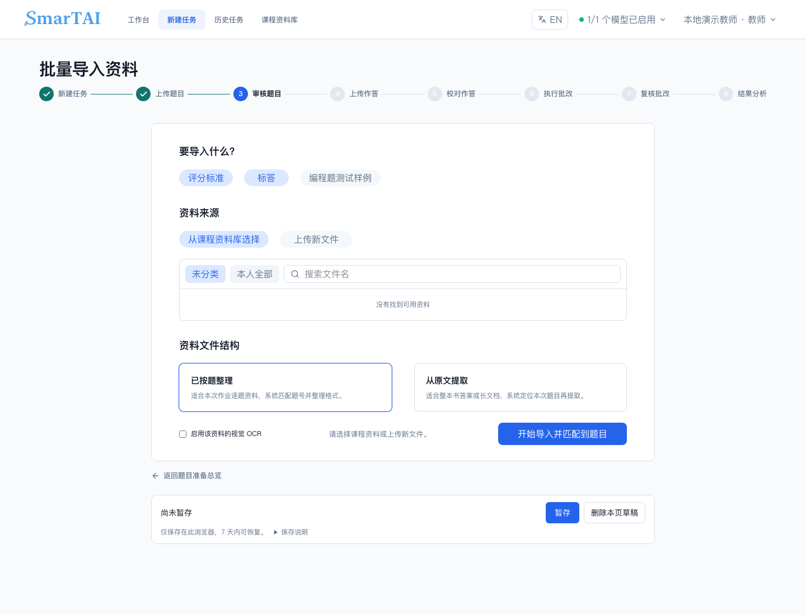
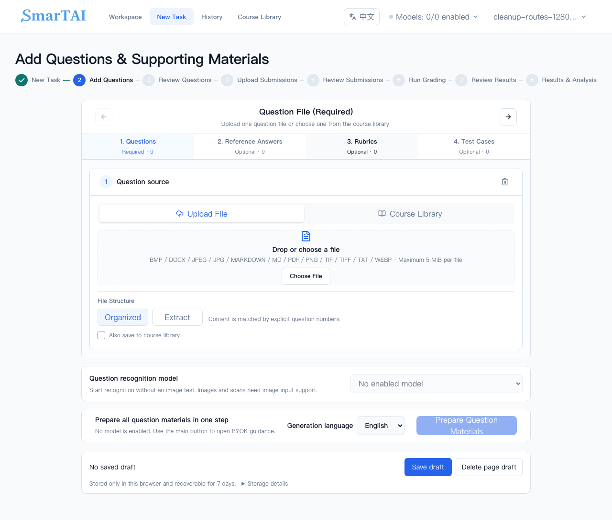
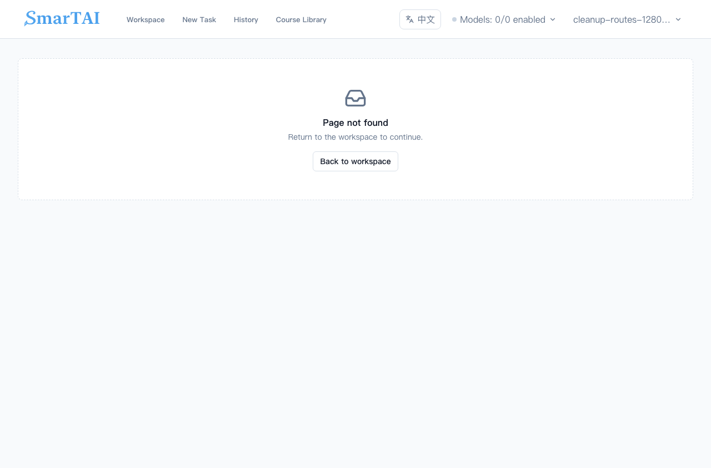
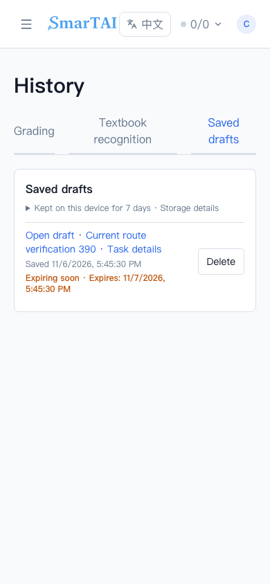
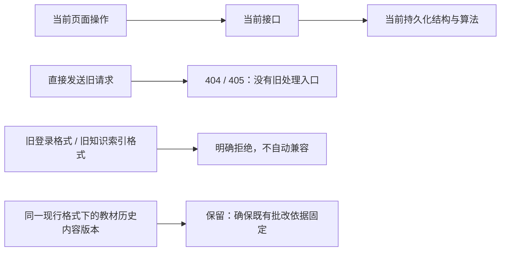

# PR302 完整清理记录

日期：2026-11-06。来源：[清除最新 main 与 PR300 的废弃代码和旧入口](codex://threads/01a1aedb-812d-74e3-b7c2-29f5574d1437)。[PR302](https://github.com/SmarTAI-2025/SmarTAI/pull/302) 累计清理内容，包括首轮清理、独立材料导入清理，以及用户追加的调用关系复查。

基线是 main `e1f8fd2542057c0a3c232e0f0b1a52bbc0b737be` + PR300 `9eedc31de3224a431f66b6d24be0141111035109`。PR302 暂以 `codex/programming-classroom-reviewed` 为 base；不包含整条 PR291。产品代码/测试/手册累计 **223 个文件变动，其中 65 个删除**；此数字不包含本报告及配图。逐文件状态见 [完整清单](changed-files.txt)。文件标记 `D` 为整文件删除，`M` 为只清理其中的旧部分。

## 1. 前端清理位置

### 已删除的独立导入页面

下面是清理前独立 `/tasks/:taskId/questions/import` 页面的真实本地截图。它位于题目审核阶段，包含“评分标准 / 标答 / 测试样例”选择、来源选择、导入按钮和本机草稿。截图来自同日 PR291 限时审计，使用合成任务；用于说明被删页面，不表示生产环境曾部署该版本。

删除页面及专属代码：

| 旧位置 | 删除范围 | 清理后行为 |
|---|---|---|
| `/tasks/:taskId/questions/import` | `QuestionMaterialImportPage` 与测试 | 普通 404，地址不跳转 |
| `…/questions/import/progress/:jobId` | `QuestionMaterialImportProgressPage` | 普通 404，不轮询旧任务 |
| `…/questions/import/review/:jobId` | `QuestionMaterialImportReviewPage`、原件预览及测试 | 普通 404，不加载或应用旧方案 |
| 本机草稿列表 | `material-import` / `material-review` 目的地址、标签、版本计算与验证脚本场景 | 无恢复链接；仅列出当前有有效目的地址的草稿 |
| 专属客户端 | `api/materialImports`、hooks、keys、types、`materialImportCopy`、旧错误文案 | 不再产生旧功能请求 |

特别处理：只删三个路由后，通用 `questions/:questionId` 会把 `import` 解释为题目 ID 并跳转。浏览器回归发现此问题后，加入唯一的 `questions/import/* → NotFoundPage` 拒绝规则。它只显示普通 404，不保留旧组件、迁移、重定向、API 或草稿兼容。

### 保留的统一准备入口

当前入口仍是 `/tasks/:taskId/upload/problems`。四个页签、资料库选择、OCR 选择、统一处理，以及缺失标答/评分标准的 AI 生成均保留。

### 旧地址与旧草稿的实际结果

桌面 1280px、手机 390px 均直接访问 25 个旧地址，断言 URL 不变、普通 404、没有脚本错误和旧导入 API 请求。下图是其中一个旧地址的结果，所有地址使用相同断言。

测试向浏览器 IndexedDB 写入两个旧导入草稿和一个当前任务信息草稿。下图仍能显示当前草稿，而两个旧草稿没有恢复入口；没有因为隐藏旧草稿而停止加载全部草稿。旧记录不迁移、不自动调用业务 API，仍受原本的到期和会话清理机制约束。

[手机四页签](images/mobile-current-task-entry.png) · [手机 404](images/mobile-retired-route.png) · [桌面草稿列表](images/desktop-current-draft-list.png) · [图片来源及 SHA-256](image-provenance.json)

## 2. PR302 累计清理清单

| 类别 | 删除内容与代码位置 | 保留边界 |
|---|---|---|
| 旧师生工作区 | `src/routes/teacher/`、`src/routes/student/` 的旧页面/测试；旧 education API/hooks、LMS 类型、角色守卫和旧导航 | 当前教师工作区、StudentUnavailablePage、课程标签及资料库 |
| 旧任务 URL | `setup`、`upload/submissions`、`upload/:kind` 旧别名与重定向 | 当前 `tasks/:taskId` 状态入口和 `submissions/upload` |
| 独立材料导入 | 上述三个页面、专属 API/hooks/types/copy、原件预览、草稿恢复；中英文手册同步删除旧流程说明 | 四页签统一准备、当前 AI completion、题目总览和详情编辑 |
| 旧后端 LMS 工作流 | `api/assignments.py`、`submissions.py`、`grading_runs.py`、`results.py`；专属 services、`submission_upload_repository`、旧测试专用 app | 当前任务 facade、共享 assignment/submission/grading repositories |
| 旧选课资源 | `/courses/{id}/students`、`/courses/{id}/enroll`；旧学生/管理员读取分支和无消费者的课程查询 | 教师课程标签、当前归属与权限验证 |
| 旧账号和邀请入口 | 开发 `/users/*`、旧 `/admin/invites` 接口/生成/兑换、旧 `/admin/users/{id}/active` 别名、未挂载的 AdminInvites/Placeholder/System 页面 | 当前注册邀请码、邮箱验证、私有后台账号权限/监控/业务配置 |
| 独立导入后端 | `task_preparation.py` 的 preflight/start/get/source/apply/draft-reference、原件复验、durable worker；`main.py` 注册；task execution/facade 的 `material_import` 分支、准入类型及错误白名单 | 当前 `question_preparation` 与 `ai_completion` 的原子写入、租约、进度、停止/继续与恢复 |
| 独立上传别名 | `upload_reference`、`upload_test_cases` 及 `_apply_auxiliary_upload`、前端封装 | 统一四种资料来源和共享匹配算法 |
| 旧解析器 | `ingest_agent.py` 的 `parse_reference_to_per_question` / `parse_test_cases_to_per_question`、专属 prompt/schema，及只测试旧 prompt 的参数 | `parse_material_import_to_candidates` 和其模型仍被统一准备直接调用，保留 |
| 无消费者前端封装 | 老单文件抽题 API/hooks/types、旧系统健康页 API/hooks/types；旧逐题分析/缓存重置、旧个人知识 CRUD、旧后台控制/统计及 refresh hook；专属 keys/types/test 残留 | 当前页面实际调用的 API、知识存储用量、当前后台读写和会话刷新实现 |
| 其他首轮死代码 | StatTile、旧 localStorage personalKnowledgeBase、旧 reviewDetail 搜索辅助模块 | 当前共享 UI、查询与持久化 |
| 旧原生编程兼容 | 自动修复旧源码映射、旧映射版本 1/2、旧输入域回执字段、临时 stdin / generated-domain 版本键 | 当前源码字节、输入域、安全执行、结果快照、人工复核与未评分语义 |
| 测试与工具 | 删除旧功能专属测试，移除旧脚本例外/浏览器场景；通用 worker/租约/原子性测试改用当前 AI completion 或明确未注册操作 | 当前统一准备、原件、OCR、编程测试用例、恢复和事务回归 |

保留历史 Alembic 迁移链和当前共享数据库模型。新增 `0032_knowledge_version_required`，取消知识片段的旧格式默认值；不转换或销毁已有业务数据，不操作真实生产数据库。

## 3. 前两轮审计和验证（截至 `15b5b68f`）

- 从公共 `main.tsx` 与私有 `admin-main.tsx` 检查静态/动态导入和 export 图：257 个非测试 TS/TSX 文件，255 个可达；余下是 API 汇总出口和全局环境类型声明。对 API 导出函数追加消费者扫描，已无“仅声明、无其他源码引用”的函数候选。详见 [source-audit.json](source-audit.json)。该检查是可达性证据，不等于所有功能都经过行为验收。
- 后端 38 个旧 HTTP 请求，在 development/test/production × 未登录/teacher/student/admin 下均检查为 404；OpenAPI 不再暴露独立导入及两个独立上传别名，同时确认当前统一准备和 AI 补全路由存在。
- 本地追加后端回归 **1,381 项通过、7 项条件跳过**，覆盖题目准备、原件、上传、OCR、草稿引用、辅助操作、工作流/租约、停止继续、恢复、编程测试材料和当前路由；前端全量 **1,767 项通过**。删除的测试都对应退休实现；混合测试只删除旧分支，保留当前行为验证。
- 本地生产构建浏览器 **70 项通过**：旧 URL/IndexedDB 草稿、四页签、当前导航、停止继续/错误恢复/额度重试、桌面手机布局、中英文公开手册。公共和私有后台构建、类型和范围检查通过。
- 测试使用临时数据库、合成账号/文件及固定模型响应，没有真实 AI 准确率、正式学生数据或生产运行验收的含义。CI 与本地日志必须对应各自实际 SHA；首轮 `d0a6c6f0` 的成功记录不能代替追加清理后的 head。
- 最终 head、CI run 和逐阶段状态见 PR302 描述及 canonical 导航目录 `docs/project_navigation/2026-11-06-retired-cleanup/material-import-removal/` 的验证记录。正式 review、合并、部署分别记录，不由测试通过推导。
- 首次追加 head 的完整 CI 检出两个 OCR 测试仍 monkeypatch 已删的 facade 别名（共3个参数用例）；改为当前 `question_sources` 工厂和实际 provider 替身，保留并加强错误传播/不重复提交断言。该失败记录保留，最终验证使用修复后的新 head。

## 4. 与 PR291 的整合约束

对照 PR291 功能 head `57b4bbaad7eb80eedc79fe92d3d1a041197d0b73`；未把整条 PR291 合入本分支。后续按以下规则处理冲突，禁止恢复被删除的独立流程：

1. `frontend/app/src/api/materialImports.ts` 的修改/删除冲突选择删除；其中 `9_060_000ms` 旧 preflight 等待例外一起消失，不移动到当前 HTTP client。
2. `backend/api/task_preparation.py` 保留 PR291 对当前统一题目准备、当前 AI completion 的总时限/单次调用规则；丢弃已删除独立 preflight、start、worker、apply 中新增的计时逻辑。
3. PR291 的 `backend/services/workflow_deadlines.py::QUESTION_TYPES` 必须移除 `material_import`；保留当前统一准备 **2.5 小时**规则。不可误删共享题目时钟或 AI completion。
4. worker 注册、执行准入、停止继续、前端路由/草稿/导出、旧专属测试都保持删除。PR291 新增的独立导入计时测试不能使被删函数重新出现；当前统一流程的计时测试保留。
5. 同时改动的 analytics/type 文件逐块合并：保留 PR291 的当前 Ask 限时和滚动频率限制，保留 PR302 对无消费者前端封装的删除。所有正式组合仍须按组合 head 重新验证。

## 5. 第三轮：按当前调用关系删除旧后端、统一数据格式

用户在 2026-11-06 明确了最终规则：已被新实现替代且当前不再使用的内容删除；当前仍在使用且没有替代的功能保留；不再为开发阶段旧账号/旧数据保留兼容。此规则取代前一轮“先保留三类待确认项”的临时决定。

### 给非技术使用者的解释

前端是用户看得到、点得到的按钮和页面；后台接口是按钮实际发出的操作请求。只删除按钮，后台未必停止接受原来的操作。因此本轮同时检查了后台的处理函数、后台排队执行的任务、数据库读写和当前页面的调用关系。确认废弃的请求会得到 404/405，不会再进入原来的业务处理。

“地址还存在”本身不能证明存在安全漏洞：原有账号权限仍然适用。这里清理的是已经没有产品用途、却仍需要维护和保护的额外入口，不能据此声称曾发现可被利用的越权漏洞。

本轮没有新增删除前端页面，所以没有“某个按钮消失”的新截图。第 1 节的真实截图继续标注 PR302 已删除的页面位置；后台变化由下表和请求回归证据说明，不把示意图当作前端截图。

### 删除与替代关系

| 清理项 | 原来是什么、为什么删 | 现在使用什么 |
|---|---|---|
| 单来源抽题 `POST /tasks/{id}/extract_problems` | 旧的一次上传一个来源并抽题的入口；当前页面和 Demo 已不调用。删除端点、source-token 分支、`problem_extraction` worker、恢复/准入注册和专属服务 | 当前四页签 `question_preparation`；其中共用的抽题算法继续保留 |
| `POST /tasks/{id}/problem-sources/preflight` | 同一份统一准备预检还暴露一个旧 URL 别名，无当前调用 | 唯一现行 `question-preparation/sources/preflight`；当前 library/draft-reference 来源入口仍保留 |
| 逐题分析与缓存清理 | 删除 `GET /analytics/{task}/per_question/{q}`、两个 `DELETE …/cache`；同时删除仅被旧端点使用的事实聚合、总结、生成图表和逐题模型调用链 | 当前 Ask/可视化分析的 grounded 计划执行，以及筛选意图接口 |
| 旧账号状态 `PATCH /admin/users/{id}/status` | 只表达启用/停用的旧接口，当前页面已改用新的访问状态控制 | `/access` 的正常、只读、禁止登录三种状态 |
| 旧后台 metrics catalog/query | 当前页面没有调用这些旧统计入口 | 当前概览仍使用共享统计函数；现行监控与分析接口保留 |
| 旧 `/knowledge/documents` CRUD 和普通原件下载 | 旧个人知识库直接增删查接口；当前资料库通过课程资料接口管理文件 | `/course-materials/*` 资料库、`/tasks/{id}/kb` 任务附件、带引用归属校验的原件下载 |
| `/assignments/{id}/knowledge-documents` GET/PUT | 已被当前任务附件入口替代的旧教材选择入口 | 任务 `/kb` 及共享的所有权、选用关系和额度控制 |
| 旧内存知识库和独立向量实现 | 运行时仍挂着混合检索器，但没有当前业务向内存库写资料；删除 `rag/store.py`、`rag/embedder.py`、组合检索器和旧文件抽文包装 | 启动直接注册持久化检索器。当前无损分块、引用、读取权限、缓存撤销校验全部保留 |
| 旧知识格式 | 删除索引 v1/v2 的算法分支、缺版本时补 `legacy`、旧运行清单自动回退，以及知识片段默认生成 `legacy` 的 ORM/数据库设置 | 现行 `bm25-structure-stems-v3`，明确的内容版本；缺版本或旧索引不能借用现行缓存 |
| 旧登录格式 | 删除无 session ID/账号版本/服务范围的旧访问令牌接纳、活动接口自动升级旧会话、无服务前缀的刷新凭据、未标记的旧密码哈希验证 | 当前可撤销会话和带标记的密码格式；登录、续期、登出、重置密码、私有后台隔离和公开 Demo 各自现行合同保留 |
| 旧代码专属测试和测试准备 | 旧功能专属测试删除；混合测试转到真实的当前入口。直接写测试知识片段的辅助函数移至 tests，API 测试创建当前可撤销会话 | 保留当前功能回归，不用测试专用鉴权绕过业务权限。评估工具 workflow_probe 同步使用当前测试会话 |

旧账号如果只保存旧密码格式，需要重置密码或重新建立测试账号；旧登录令牌必须重新登录。此 PR 不替用户清空数据库，也不执行真实账号重置。

### 确认仍在使用，保留的内容

| 看起来相似的内容 | 当前调用/作用 | 为什么需要保留 |
|---|---|---|
| 资料库 vs 任务教材 | `api/courseMaterials.ts` 管理可复用资料；`api/kb.ts` 管理任务选用和任务内上传 | 一个是“存入资料柜”，另一个是“本次任务选哪几份”；共享同一套持久化文档，不是新旧两套存储 |
| 知识搜索、解析进度、暂停/恢复/重试、引用原文 | `KnowledgeSearchPanel`、当前资料库/任务教材页面仍请求 `/knowledge/search`、coverage、resume/cancel/retry、citations | 都是现行功能，不能因路径含 `documents` 而一起删除 |
| `/analytics/{task}/query` 与 Ask | `VisualizationAnalysisPage` 仍使用 query；当前 Ask 页面使用 ask；均进入现行 grounded 执行 | 当前两个消费入口仍存在，没有另留旧总结/旧图表算法 |
| 改访问状态、撤销登录、发送密码重置邮件 | `AdminUserDetailPage` 通过动态路径发送 `/access`、`sessions/revoke`、`password-reset` | 三种不同管理行为。撤销会话和重置密码不是已经废弃的旧接口；此前仅依据旧 API 包装无人调用的判断已纠正 |
| assignment/submission/grading 共享模型 | 当前教师任务流程直接使用其 repositories | 这些名字对应现行统一数据库。旧 HTTP 页面删除不代表共享底层也可以删除 |
| 教材内容快照 | 已开始的批改固定教材内容版本，引用能对应原文 | 内容的新旧与数据格式的新旧不同；保留现行格式的历史内容，不恢复 v1/v2 检索算法 |
| 历史数据库迁移 | 从空库创建当前结构、执行升级/回退验证 | 是创建当前数据库的步骤记录，不是运行时同时使用旧结构。新增迁移取消旧默认值，而非重写已存在的迁移文件 |
| `parse_material_import_to_candidates` 等共享算法 | 当前统一准备直接调用 | 名字含 import 不代表是已删除的独立导入页面；当前资料匹配仍依赖它 |

以上项目已按实际调用关系处理，本轮没有需要用户再次决定、却仍阻塞已确认清理的项目。未把“项目内出现 legacy 字样”作为删除依据。

## 6. 第三轮验证与证据边界

- 先运行旧请求拒绝回归，删除前 28 项失败，删除后通过；随后扩为公共/私有服务 × 未登录/无效凭据 × 15 种旧请求，60 项通过。此验证直接向后端发请求，覆盖绕过前端的访问方式。
- 前端全量 1,767 项通过；类型/范围检查、公共构建、私有后台构建通过。此次前端只收紧知识内容版本类型，没有新增产品交互。
- 当前知识存储、权限、冻结教材、原件引用、上传与账号边界组合回归 264 项通过；数据库迁移和账号回归 49 项通过。索引与现行统计专项 17 项通过，包含缺版本不能命中已缓存索引、旧内容格式不能读回的回归。
- 首次完整后端运行用于发现遗漏：旧会话期望、测试 fixture 导入和一个沙箱端口权限问题已定位；不是完整通过记录。受影响的 365 项测试修正后全部复跑通过，最终整套验证以提交后的精确 head CI 为准。
- 本地浏览器追加 7 项通过：真实当前登录、桌面/手机 Word 上传与引用下载、旧 URL 拒绝、旧草稿隐藏和当前任务入口。测试账号仅写入临时 SQLite；没有为测试恢复旧令牌自动升级。首次全量浏览器的环境/旧令牌问题记录保留，完整浏览器最终结果以 CI 为准。
- 浏览器、完整 SQLite/PostgreSQL、原生编程 OCI 的最终结果、实际 SHA 和运行链接保存在 PR302 描述以及 canonical `验证与整合记录.md` 的本轮追加记录。历史 head 的成功不代替新 head。
- 所有验证使用合成数据与固定模型响应，无真实付费模型调用、生产数据变更、合并或部署；正式代码 review 与用户验收单独记录。
